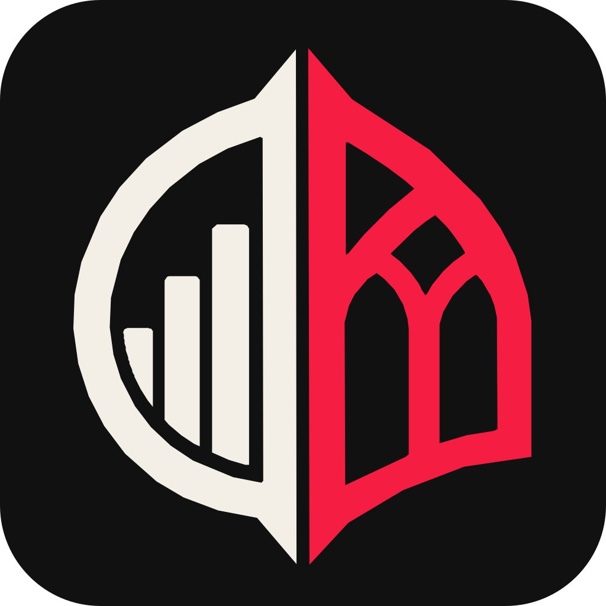

# stack-cap-bench

Live: <https://sstoehrm.github.io/stack-cap-bench/> ·
Source: <https://github.com/sstoehrm/stack-cap-bench> · Code: [MIT](LICENSE) ·
Data: [CC BY 4.0](LICENSE-DATA)

One page that shows what a headless coding agent spends — tokens, dollars,
minutes, attempts, tool calls — building the same projects in different tech
stacks. The numbers come from
[token-comparision](https://github.com/sstoehrm/token-comparision); the page is
built with [hammer](https://github.com/sstoehrm/hammer) and draws its chart and
the evil-mode nave by hand on canvases, as `hammer.canvas` loops.

- **Topics**: runs are grouped by project kind — *Web development* (projects 2
  and 3) and *CLI tools* (project 1) — plus *Long run* (project 5, `bookit`,
  20 steps), kept apart because a run costs about 10× a small project's and
  would dominate the web averages (`project-topics` in `scripts/import.clj`).
  Each topic gets headline tiles and a stack × model·effort table.
- **Compare**: cost bars grouped by stack, per topic and project: one bar per
  model and effort level, so an even staircase means cost rises in step with
  the effort. Each stack has its own hue (fixed per topic, validated for
  colour blindness between neighbours); effort is its shade, lighter for
  lower; each model has its own texture (Opus solid, Fable diagonal, GPT-6 Sol
  horizontal, GPT-6 Astra dotted) and a chip to show or hide it.
- **Two modes**, switched at the top right and remembered per browser (or
  forced with `#serious` / `#evil` in the URL):
  - *Serious* (default): functional glass, monospace, light and dark
    (follows the OS, or pick with the theme button).
  - *Evil*: the gothic cathedral and the judgement, per topic: the Holy
    Stacks (best mean cost rank across the topic's configurations) and the
    Diabolical Stacks (worst first), up to three each and never overlapping.
- **Niche stacks** (`data/niche`: the hammer stacks and other small
  frameworks and languages) never appear in serious mode. Evil mode shows
  them once "Admit the niche frameworks", the gate above the judgement, is
  pressed, remembered per browser.
- **Agent**: every run records the agent harness and version that produced it
  (`claude-code 2.1.282`) in `results.json`; the page does not show it.
- Every value is the mean over **complete** runs (every step passed), per
  project first, then across the topic's projects. Stack colours are fixed,
  never by rank.

## Data

`public/results.json` is the only input. The page fetches it at runtime, so
new data needs no rebuild. Regenerate it from a token-comparision checkout:

```sh
bb import ../token-comparision
```

`main` only takes pull requests that pass CI, so a scheduled or repeated
import publishes with

```sh
bb data-pr ../token-comparision
```

which imports into a throwaway worktree of `origin/main`, pushes a
`data/<sha>` branch and opens a PR with auto-merge, so the data lands once CI
is green. It leaves your checkout alone and does nothing when the data is
unchanged.

Or edit it by hand:

```json
{
  "source": "token-comparision@b5564fe",
  "imported": "2026-09-26",
  "topics":   [{"id": "web", "label": "Web development", "projects": [2, 3]}],
  "projects": [{"id": 2, "name": "spendly", "kind": "web", "steps": 5}],
  "runs": [{"project": 2, "stack": "svelte-java", "run_id": "20260925-061616",
            "model": "claude-opus-5-5", "effort": "high", "agent": "claude-code 2.1.282",
            "input_tokens": 3294556, "output_tokens": 53614, "cost_usd": 3.2,
            "wall_min": 9.9, "attempts": 5, "tool_calls": 79,
            "steps_passed": 5, "complete": true}]
}
```

The import keeps only the current hammer stacks (`clojure+hammer`,
`babashka+hammer`) and drops their versioned experiment variants
(`*+hammer-0.1.0*`).

`scripts/import.clj` copies the per-run summary rules from token-comparision's
`harness/src/harness/report.clj` (`run-summaries`), so the numbers match its
reports. Change both together.

## Build

Needs Node, Java and the Clojure CLI. hammer is a git dependency in `deps.edn`,
pinned to its [v0.1.0](https://github.com/sstoehrm/hammer/releases/tag/v0.1.0)
release.

```sh
npm install
bb dev       # watch build on http://localhost:8290
bb release   # optimized build into public/js
bb test      # node tests (jsdom)
bb serve     # serve public/ on http://localhost:8290
```

`public/` is the whole site after `bb release`. Every push to `main` runs the
tests, builds it and publishes it to GitHub Pages
(`.github/workflows/pages.yml`).

A separate workflow, `.github/workflows/vuln-gate.yml`, runs the
vulnerability gate on pushes, pull requests and daily: SBOMs of the npm and
deps.edn dependencies, scanned with OSV-Scanner, failing on CISA KEV or EPSS ≥
0.1 with CVSS ≥ 7.0. It does not block the Pages deploy. Policy and how to
suppress a finding:
[.github/actions/vuln-gate/README.md](.github/actions/vuln-gate/README.md).

## License

Two licenses, one for each kind of thing in this repository, plus the fonts' own:

| What | License | What you may do |
|------|---------|-----------------|
| **Code**: everything except the data and the fonts (`src/`, `scripts/`, the stylesheets, `index.html`, build files) | [MIT](LICENSE) | Use, copy, modify and ship it, commercially too. Keep the copyright and license notice in copies of the code. |
| **Data**: `public/results.json` | [CC BY 4.0](LICENSE-DATA) | Anything, commercially too: analyse it, chart it, merge it into your own benchmark, publish or sell the result. Give credit and say if you changed it. |
| **Fonts**: `public/fonts/` (Cinzel, Cormorant Garamond, JetBrains Mono) | [SIL OFL 1.1](public/fonts/) | Third-party fonts under their own license, text next to each font. |

Both licenses are permissive and ask for one thing: attribution. For the data,
a line like this is enough:

> Data: [Stack Cap Bench](https://github.com/sstoehrm/stack-cap-bench) by
> Sören Stöhrmann, [CC BY 4.0](https://creativecommons.org/licenses/by/4.0/)

Both come without warranty: the numbers are measurements of a few runs, not
guarantees.

The compiled page bundles ClojureScript, the Google Closure Library and
hammer; their licenses are listed in
[THIRD_PARTY_NOTICES.md](THIRD_PARTY_NOTICES.md).

## Privacy

The page collects no personal data: no cookies, no analytics, and no requests
to anyone but its own host (the fonts are served from `public/fonts/`, not
Google Fonts). It keeps the chosen mode, theme and niche setting in your
browser's `localStorage`, which never leaves your browser. The site is hosted
on GitHub Pages, which logs visitors' IP addresses; see the
[GitHub Privacy Statement](https://docs.github.com/en/site-policy/privacy-policies/github-general-privacy-statement).

## Security

Report vulnerabilities privately, see [SECURITY.md](SECURITY.md).
